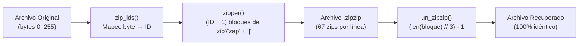

<div align="center">

# ZIPZIP (`zip_zip`)

**¿Por qué comprimir archivos cuando puedes transformarlos en millones de `"zip"` y `"zap"`?**


*Un codificador y decodificador binario reversible que convierte cualquier archivo (PDFs, imágenes, texto o ejecutables) en un mar infinito de `zip` y `zap`.*

</div>

---

## ¿Qué es `zipzip`?

**`zipzip`** es un sistema de codificación binaria sin pérdida (*lossless*) escrito en Python. En lugar de reducir el tamaño de tus archivos como un `.zip` tradicional, **`zipzip` toma el camino opuesto**: lee los bytes crudos (`0`–`255`) de cualquier archivo y traduce cada byte en secuencias de las palabras `"zip"` y `"zap"` separadas por `"|"`.

Al desencriptar el archivo `.zipzip`, el archivo original se reconstruye **byte por byte de forma exacta**.

---

## ¿Cómo funciona?



1. **Lectura Binaria (`bytes`):** Se lee cualquier archivo en modo binario (`"rb"`), obteniendo valores enteros entre `0` y `255` por cada byte.
2. **Codificación (`zipper`):**
   - Cada byte con valor `N` se convierte en `N` repeticiones aleatorias de `"zip"` (80% de probabilidad) o `"zap"` (20% de probabilidad), cerrando siempre con un `"zip|"`.
   - Cada **67 bloques** se inserta automáticamente un salto de línea (`\n`) para mantener el archivo `.zipzip` visualmente alineado.
   - Incluye una barra de progreso en consola con 8 *checkpoints* (`12.5%` → `100%`).
3. **Decodificación (`un_zipzip`):**
   - Como tanto `"zip"` como `"zap"` miden exactamente **3 caracteres**, el azar no afecta la reconstrucción.
   - Se eliminan los saltos de línea, se divide por `"|"` y se recupera el byte original mediante la fórmula:
     $$\text{byte} = \frac{\text{len(bloque)}}{3} - 1$$

### Ejemplo visual de codificación

| Byte Original | Valor Decimal | Representación en `.zipzip` | Largo del bloque |
| :---: | :---: | :--- | :---: |
| `\x00` | `0` | `zip\|` | `3` |
| `\x01` | `1` | `zipzip\|` *(o `zapzip\|`)* | `6` |
| `\x03` | `3` | `zipzapzipzip\|` | `12` |
| `'A'` | `65` | `zipzipzap...zip\|` *(66 veces en total)* | `198` |

---

## Estructura del Proyecto

```text
zipzip/
├── encoder.py          # Clase zip_zip: convierte bytes a formato .zipzip
├── decoder.py          # Clase unzip_zip: reconstruye los bytes originales
├── test.py             # Script de prueba completa (PDF -> .zipzip -> PDF)
├── sample/             # Archivos de prueba y salidas generadas
│   ├── pdf.pdf         # PDF original de muestra
│   ├── pdf.zipzip      # Archivo codificado en formato zipzip
│   ├── pdf_unziped.pdf # PDF reconstruido y funcional
│   └── the-veredict.txt
└── README.md
```

---

## Uso Rápido

### 1. Ejecutar la prueba incluida

```powershell
python test.py
```

Verás la barra de progreso en tiempo real:

```text
12.5% ====
25.0% ========
37.5% ============
50.0% ================
62.5% ====================
75.0% ========================
87.5% ============================
100.0% ================================
ZIP ZIP COMPLETE :D
```

### 2. Codificar y decodificar cualquier archivo en tu código

```python
from encoder import zip_zip as zz
from decoder import unzip_zip as uz

# 1. Leer cualquier archivo en binario
with open("sample/pdf.pdf", "rb") as f:
    data = f.read()

# 2. Encriptar a .zipzip
encoder = zz(data)
ids = encoder.zip_ids(data)
zipped_text = encoder.zipper(ids)

with open("sample/pdf.zipzip", "wb") as f:
    f.write(zipped_text.encode("utf-8"))

# 3. Desencriptar de vuelta al archivo original
with open("sample/pdf.zipzip", "r", encoding="utf-8") as f:
    zipped_content = f.read()

decoder = uz(encoder.file_to_zip)
recovered_bytes = decoder.un_zipzip(zipped_content)

with open("sample/pdf_unziped.pdf", "wb") as f:
    f.write(recovered_bytes)

assert data == recovered_bytes  # ¡100% idéntico byte por byte!
```

---

<div align="center">
  <sub>Hecho con mucho <code>zip</code> y un poco de <code>zap</code> </sub>
</div>
