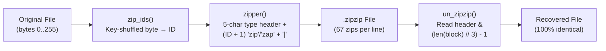

<div align="center">

# ZIPZIP (`zip_zip`)

**Why shrink files when you can transform them into millions of `"zip"` and `"zap"`?**


_A lossless, key-encrypted binary encoder, decoder, and interactive CLI that turns any file (PDFs, images, text, audio, or binaries) into an endless sea of `zip` and `zap` — and even lets you listen to it._

</div>

---

## What is `zipzip`?

**`zipzip`** is a reversible, lossless binary encoding system written in Python. Instead of making your files smaller like a traditional `.zip` archive, **`zipzip` goes in the exact opposite direction**: it shuffles the byte space using a generated decryption key, tags the file with a 5-letter file-type signature, and turns every raw byte (`0`–`255`) into sequences of `"zip"` and `"zap"` delimited by `"|"`.

When decoded with the matching key, the original file is reconstructed **byte-for-byte with its original extension automatically restored**.

---

## Features

- **100% Lossless Reconstruction:** Every byte is recovered identically.
- **Key-Based Byte Shuffling:** Each encoding generates a unique 6-character hex decryption key (`secrets.token_hex(3)`) used to shuffle the `0..255` byte mapping.
- **Automatic File-Type Detection:** Embeds a 5-character `z/i/p/a` header so `unzip` automatically knows which extension to restore.
- **Interactive CLI (`zipzip`):** Built with Python's `cmd.Cmd`, featuring directory navigation (`cd`, `ls`), file selection (`zap`, `chezip`, `cleanzip`), encoding (`zip`), and decoding (`unzip`).
- **Audio Preview (`zip -l`):** Uses `pyttsx3` to synthesize a spoken `.aiff` sample of random `"zip"`/`"zap"` blocks from your encoded file.
- **Live Progress & Stats:** Displays an 8-checkpoint progress bar (`12.5%` → `100%`) along with total `zip`, `zap`, and character counts.

---

## How It Works



1. **Key & Byte Mapping (`zip_ids`):** Generates a random 6-character hex key (or uses a provided one) to seed a deterministic shuffle of all 256 possible byte values (`0`–`255`).
2. **File-Type Header (`zip_file_type`):** Prepends a unique 5-letter identifier (made of `z`, `i`, `p`, `a`) followed by `|` so the decoder can restore the file extension automatically.
3. **Encoding (`zipper`):**
   - Each mapped ID `N` becomes `N` random repetitions of `"zip"` (80% probability) or `"zap"` (20% probability), always ending with `"zip|"`.
   - Every **67 blocks**, a newline (`\n`) is inserted to keep the `.zipzip` file neatly formatted.
   - Prints a live progress bar across 8 checkpoints (`12.5%` → `100%`).
4. **Decoding (`un_zipzip`):**
   - Strips line breaks and reads the leading 5-character header to determine the file extension.
   - Because both `"zip"` and `"zap"` are exactly **3 characters** long, the randomness does not affect recovery.
   - Recovers each ID using:
     $$\text{ID} = \frac{\text{len(block)}}{3} - 1$$
   - Reverses the key-shuffled mapping to restore the exact original bytes.

### Visual Encoding Example

| Mapped ID | Representation in `.zipzip`             | Block Length |
| :-------: | :-------------------------------------- | :----------: |
|    `0`    | `zip\|`                                 |     `3`      |
|    `1`    | `zipzip\|` _(or `zapzip\|`)_            |     `6`      |
|    `3`    | `zipzapzipzip\|`                        |     `12`     |
|   `65`    | `zipzipzap...zip\|` _(66 tokens total)_ |    `198`     |

### Supported File-Type Headers

`.txt`, `.pdf`, `.docx`, `.xlsx`, `.pptx`, `.jpg`, `.png`, `.mp3`, `.mp4`, `.zip`, `.html`, `.css`, `.js`, `.py`, `.json` _(unlisted extensions default to `.txt`)_.

---

## Installation

Requires **Python 3.8+**. Clone the repository and install the package (using a virtual environment is recommended):

```bash
git clone https://github.com/Bimbot-afk/zipzip-storage.git
cd zip_zip
python -m venv venv
source venv/bin/activate   # On Windows: venv\Scripts\activate
pip install -e .
```

---

## Quick Start (Interactive CLI)

Launch the interactive CLI from anywhere in your active environment:

```bash
zipzip
```

### Available Commands

| Command       | Description                                                                 |
| :------------ | :-------------------------------------------------------------------------- |
| `ls`          | Lists files in the current directory with selection numbers (`1_file`, ...) |
| `cd <folder>` | Changes the current working directory                                       |
| `zap <num>`   | Selects a file by its number from `ls`                                      |
| `chezip`      | Displays the currently selected file                                        |
| `cleanzip`    | Clears the current file selection                                           |
| `zip`         | Encodes the selected file to `.zipzip` and prints the decryption key        |
| `zip -l`      | Encodes the selected file and generates a `.aiff` audio preview             |
| `unzip`       | Prompts for the decryption key and restores the selected `.zipzip` file     |
| `help` / `?`  | Lists all available commands                                                |
| `exitzip`     | Exits the CLI                                                               |

> [!WARNING]
> `zip` deletes the original file after writing the `.zipzip` output, and `unzip` deletes the `.zipzip` file after restoring the original. Make sure to **save your decryption key**!

### Example Session

```text
>>> cd sample
Current Folder: .../zip_zip/sample
>>> ls
1_pdf.pdf
2_the-veredict.txt
3_verity.jpg
>>> zap 2
File .../zip_zip/sample/the-veredict.txt selected
>>> zip -l
12.5% ====
25.0% ========
37.5% ============
50.0% ================
62.5% ====================
75.0% ========================
87.5% ============================
100.0% ================================
ZIP ZIP COMPLETE :D
File successfully compressed to: .../zip_zip/sample/the-veredict.zipzip
🔑 Decryption key (save this to unzip!): A3F91C
Total zip: ...
Total zap: ...
Total characters: ...
```

To restore the file later:

```text
>>> ls
>>> zap <number_of_zipzip_file>
>>> unzip
Enter the decryption key >>> A3F91C
File successfully recovered to: .../zip_zip/sample/the-veredict.txt
```

---

## Project Structure

```text
zip_zip/
├── pyproject.toml              # Package metadata, dependencies & `zipzip` CLI script
├── README.md
├── sample/                     # Sample files for testing
│   ├── pdf.pdf
│   ├── the-veredict.txt
│   └── verity.jpg
└── zipzip_storage/
    ├── __init__.py
    ├── main.py                 # Interactive `cmd.Cmd` CLI (`zipzip`)
    ├── encoder.py              # `zip_zip` class: key shuffling, header & encoding
    ├── decoder.py              # `unzip_zip` class: header detection & decoding
    └── zip_listen.py           # `zip_listen` class: TTS audio preview (`.aiff`)
```

---

<div align="center">
  <sub>Made with lots of <code>zip</code> and a little bit of <code>zap</code></sub>
</div>
